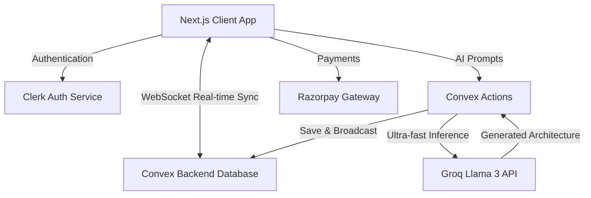

<div align="center">
  
  <h1 align="center">Slate: The Visual Workspace for Modern Teams</h1>
  
  <p align="center">
    <strong>Infinite Canvas. Real-time Documentation. AI Architecture Generation.</strong>
  </p>
  
  <p align="center">
    <a href="https://nextjs.org"></a>
    <a href="https://convex.dev"></a>
    <a href="https://clerk.com"></a>
    <a href="https://reactflow.dev"></a>
    <a href="https://groq.com"></a>
  </p>
</div>

---

## 🚀 Overview

**Slate** is a premium, enterprise-grade SaaS application designed to eliminate the friction between thinking, drawing, and documenting. It provides modern software teams with a unified workspace that seamlessly combines an infinite whiteboard canvas, real-time rich-text markdown documentation, and AI-powered system architecture generation.

Whether you are brainstorming high-level system designs, writing LLDs (Low-Level Designs), or collaborating with your team in real-time, Slate ensures all your work lives in one connected environment.

---

## 🧠 System Architecture

Slate utilizes a highly modern, serverless architecture optimized for ultra-low latency and real-time multiplayer collaboration.



---

## ✨ Enterprise Features

### 🎨 Infinite Visual Canvas
Powered by **React Flow**, the canvas allows teams to map out architectures, draw mind maps, and visualize complex microservice interactions. Includes custom nodes, dynamic edge routing, and drag-and-drop capabilities.

### 📝 Real-Time Markdown & Rich Text
Our custom text editor is built on **Tiptap**. It supports:
- Notion-style slash commands (`/`).
- Seamless Markdown shortcuts.
- Drag-and-drop image uploads directly onto the page.
- Real-time multiplayer cursors and collaborative editing.

### 🤖 Instant AI Architecture (Groq LLM)
Why draw manually when AI can do it for you? Describe your system (e.g., *"E-Commerce Microservices with Kafka and Postgres"*), and Slate will use **Groq's** blazing-fast LLMs to instantly generate a complete, editable Node/Edge architecture directly onto your canvas.

### ⚡ Multiplayer Collaboration
Built natively on **Convex**, every change on the canvas or the document is synchronized across all connected clients with sub-millisecond latency. No manual saving required.

### 💳 SaaS Subscriptions & Billing
Integrated with **Razorpay** for seamless checkout experiences, allowing users to upgrade to premium tiers seamlessly.

---

## 🛠️ Technology Stack

| Category | Technology | Purpose |
| :--- | :--- | :--- |
| **Frontend Framework** | [Next.js 14](https://nextjs.org/) | App Router, Server Components, SSR |
| **Styling** | [Tailwind CSS](https://tailwindcss.com/) & [Shadcn UI](https://ui.shadcn.com/) | Premium, responsive, glassmorphism UI |
| **Realtime DB** | [Convex](https://www.convex.dev/) | WebSockets, state sync, backend functions |
| **Authentication** | [Clerk](https://clerk.com/) | JWT auth, OAuth, User Management |
| **Canvas Engine** | [React Flow](https://reactflow.dev/) | Interactive node-based UI |
| **Rich Text Editor**| [Tiptap](https://tiptap.dev/) | Headless, highly customizable text editor |
| **AI Inference** | [Groq API](https://groq.com/) | Fast LLM token generation |
| **Payments** | [Razorpay](https://razorpay.com/) | Subscription & billing handling |
| **Email Delivery** | SMTP Configuration | Automated workspace invites |

---

## 🔐 Environment Variables Detail

To deploy or run Slate locally, you must provide the following variables in your `.env.local` file. 

| Variable | Description | Where to find it |
| :--- | :--- | :--- |
| `CONVEX_DEPLOYMENT` | Identifies your specific Convex backend instance. | Convex Dashboard |
| `NEXT_PUBLIC_CONVEX_URL` | Public WebSocket endpoint for Convex. | Convex Dashboard |
| `NEXT_PUBLIC_CONVEX_SITE_URL`| HTTP actions endpoint for Convex. | Convex Dashboard |
| `NEXT_PUBLIC_CLERK_PUBLISHABLE_KEY`| Frontend public key for Clerk Auth. | Clerk Dashboard > API Keys |
| `CLERK_SECRET_KEY` | Backend secret key for Clerk Auth. | Clerk Dashboard > API Keys |
| `CLERK_WEBHOOK_SECRET` | Used to securely verify Clerk webhook events. | Clerk Dashboard > Webhooks |
| `NEXT_PUBLIC_RAZORPAY_KEY_ID` | Your Razorpay API Key ID (Test or Live). | Razorpay Dashboard |
| `RAZORPAY_KEY_SECRET` | Your Razorpay API Secret Key. | Razorpay Dashboard |
| `GROQ_API_KEY` | API Key for generating AI architectures. | Groq Developer Console |
| `SMTP_HOST` | Hostname for your email provider (e.g., `smtp.gmail.com`). | Email Provider |
| `SMTP_PORT` | Port for SMTP (usually `587` or `465`). | Email Provider |
| `SMTP_USER` | Your email address or SMTP username. | Email Provider |
| `SMTP_PASS` | Your SMTP App Password. | Email Provider |
| `SMTP_SECURE` | Set to `true` for 465, `false` for 587. | Setup preference |

*(You will also need to set standard Clerk redirect URLs such as `NEXT_PUBLIC_CLERK_SIGN_IN_URL=/sign-in`)*.

---

## 🏁 Getting Started (Local Development)

### 1. Clone the Repository
```bash
git clone https://github.com/your-username/slate.git
cd slate
```

### 2. Install Dependencies
```bash
npm install
```

### 3. Setup Environment
Duplicate `.env.example` (or create a `.env.local` file) and fill in the environment variables referenced above.

### 4. Run Convex Backend
In a separate terminal, start your Convex development environment:
```bash
npx convex dev
```

### 5. Start Next.js Client
Start the frontend development server:
```bash
npm run dev
```

Your application will now be running on [http://localhost:3000](http://localhost:3000).

---

<div align="center">
  <i>Built with passion for modern engineering teams.</i>
</div>
