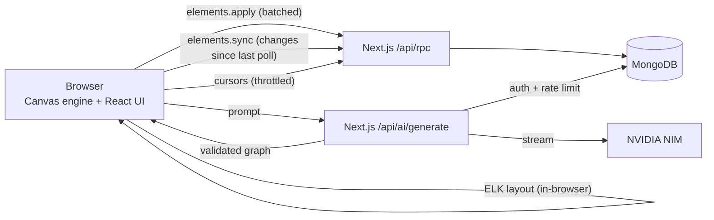

<div align="center">
  
  <h1>Slate</h1>
  <p><strong>An infinite canvas for software teams: draw it, generate it with AI, or write it as code.</strong></p>
  <p>
    <a href="https://nextjs.org"></a>
    <a href="https://www.mongodb.com/atlas"></a>
    <a href="https://clerk.com"></a>
    <a href="https://build.nvidia.com"></a>
  </p>
</div>

---

## What it does

| | |
| :-- | :-- |
| **Whiteboard** | Custom canvas engine: 11 shapes, smart connectors (elbow / curve / straight) that route around other nodes, text, sticky notes, frames, pen + highlighter, images, rotate / resize / group / lock, alignment guides, grid snapping, minimap, dark & light themes. |
| **Icon library** | 170+ real product logos (Postgres, Kafka, Next.js…), 40 AWS / GCP / Azure services, and all ~2,000 Lucide glyphs. Drop them as node cards or bare icons; search understands aliases (`k8s`, `postgres`). |
| **AI diagrams** | Describe anything. Slate AI (NVIDIA-hosted models) produces a structured graph, and the browser lays it out with ELK so nothing overlaps. Follow-up prompts edit the same diagram in place. Architecture, flowchart, ER, mind map and sequence diagrams. |
| **Diagram as code** | Eraser-style text syntax (`API gateway > Orders: gRPC`, groups, icons, colours) with the same layout engine. Round-trips: any selection can be turned back into code. 10 built-in templates. |
| **Collaboration** | Live cursors with names, teammates' selections, live drag previews, "anyone with the link" sharing (view / edit), workspace roles, per-element sync so edits never overwrite each other. |
| **Export** | PNG (1-4x, transparent), SVG, JSON; import JSON; copy PNG to clipboard. |
| **Docs** | Rich-text document (Tiptap) next to the canvas. The split view has a draggable divider (20-80%, remembered), one-click layout presets, a reading header (word count, copy / download Markdown) and "insert canvas snapshot into document". |
| **Import code** | Paste a `docker-compose.yml`, SQL schema or folder tree: Slate parses it exactly (no AI) into a diagram **and** writes the documentation (service table, port map, environment requirements, ER tables) into the document. Any other code goes through Slate AI. |
| **Cloud cost (FinOps)** | A live "estimated cloud cost / month" badge for the AWS / GCP / Azure services on the board, with cost-saving tips. Pro adds the per-component breakdown and CSV export. |
| **Traffic simulator** | Animated packets flow along your arrows (amber for async links) and components many others depend on, with no redundancy, get a pulsing single-point-of-failure badge. |
| **Interview mode** | 45-minute countdown, requirement checklist, back-of-the-envelope scale calculator and an architecture review (instant structural check, or a written AI review). |
| **Billing** | Free / Pro / Team plans paid through Razorpay (checkout, signed verification, webhooks). Free: 3 boards and 15 AI credits a month. |

A free, no-account board lives at **`/playground`** (stored in your browser).

---

## Quick start

```bash
npm install
cp .env.example .env.local     # fill in the values (see below), at least MONGODB_URI and the Clerk keys
npm run dev                    # http://localhost:3000
```

There is nothing to deploy besides the app: collections and indexes are created on first connection.

> **Coming from the Convex version?** Export your data once with `npx convex export --path backups/convex.zip`,
> unzip it into a folder, then `npm run db:migrate -- <folder> --dry-run` and `npm run db:migrate -- <folder>`.
> Ids are kept, so existing `/canvas/<id>` links still work, and the copy is read back and compared with the
> export. Then `npm run clerk:sync` makes sure every Clerk user exists in MongoDB and owns a workspace.

### Environment

See [`.env.example`](.env.example) for the full list. The ones that matter most:

| Variable | Purpose |
| :-- | :-- |
| `MONGODB_URI` | MongoDB connection string (Atlas). The database name at the end of the URI is used. |
| `NEXT_PUBLIC_CLERK_PUBLISHABLE_KEY`, `CLERK_SECRET_KEY` | Clerk auth. |
| `CLERK_WEBHOOK_SECRET` | Signing secret of the Clerk webhook `https://<your-domain>/api/webhooks/clerk` (events `user.created`, `user.updated`, `user.deleted`), which keeps MongoDB in step with Clerk. |
| `NVIDIA_API_KEY` | **AI generation.** Free key from <https://build.nvidia.com> → profile → API Keys. Without it AI is disabled and the panel offers templates instead. |
| `NVIDIA_MODELS` | Optional comma-separated model chain, first = preferred. |
| `AI_RATE_LIMIT_PER_HOUR` | Optional per-user cap (default 40; plus 6/minute burst). |
| `NEXT_PUBLIC_RAZORPAY_KEY_ID`, `RAZORPAY_KEY_SECRET`, `RAZORPAY_WEBHOOK_SECRET` | Razorpay checkout, payment verification and webhooks. |
| `RAZORPAY_PLAN_{PRO,TEAM}_{MONTHLY,ANNUAL}` | Optional Razorpay plan ids for recurring billing. Without them checkout falls back to a one-time order for the first period. |

### AI models (NVIDIA)

Groq has been replaced by NVIDIA NIM's OpenAI-compatible API. The default chain, best first:

1. `nvidia/nemotron-3-ultra-550b-a55b`: highest capability, great at structured diagram JSON
2. `nvidia/nemotron-3.5-super-vl-120b-a12b`: fast, low latency
3. `nvidia/nemotron-3-super-120b-a12b`: efficient fallback MoE

Each request tries a model, feeds failures back for one repair pass, then falls through to the next model on
timeouts / 5xx / rate limits. Check which work for **your** key (free-tier availability varies):

```bash
npm run ai:check            # model availability, latency, JSON compliance
npm run ai:check -- --full  # also runs a real end-to-end generation
```

---

## How it works



* **One row per element** instead of one JSON blob per board. A drag is *one* small write, concurrent editors never
  overwrite each other, and clients poll for *what changed since their last poll* (a per-board change counter),
  not for the whole board.
* **Layout runs in the browser.** The server only proxies the model and validates JSON, so AI cost scales with
  model usage, not server CPU.
* **Presence is throttled and coalesced**: at most one in-flight update per tab, with the send rate backing off
  as a room grows; remote cursors are interpolated client-side so low update rates still look smooth.
* **Access control lives in one resolver** (`lib/server/access.ts`): workspace roles, legacy owners and link sharing.
* **One door to the database**: the browser only talks to `POST /api/rpc`, which checks the Clerk session, validates the
  arguments with zod and runs a declared server function (`lib/server/*`). Nothing else is reachable.

Details, trade-offs and the upgrade path to a dedicated realtime service are in
[`docs/ARCHITECTURE.md`](docs/ARCHITECTURE.md).

### Upgrading existing boards

Boards saved by the previous version (the whole canvas in one JSON string) are converted to per-element rows
the first time an editor opens them (`lib/canvas/legacy.ts` → `elements.importLegacy`). Viewers see the converted
board immediately; nothing is lost. Images larger than 250 KB that were stored inline are skipped with a notice.

---

## Keyboard shortcuts

Press **`?`** in the app. Highlights: `V` select · `H` hand · `R`/`O`/`D` shapes · `A` arrow · `L` line · `P` pen ·
`T` text · `N` sticky · `F` frame · `E` eraser · `Ctrl+K` command palette · `Tab` add connected node ·
`Ctrl+D` duplicate · `Ctrl+G` group · `Shift+1` fit.

---

## Project layout

```
app/                 routes: dashboard, canvas/[id], playground, api/ai/*, api/billing/razorpay/*
components/canvas/   React UI: toolbar, properties, library, export, share, text editor, cursors
components/ai-panel/ AI drawer (prompting, progress, edit-in-place, code view, import code)
components/billing/  pricing modal (Razorpay Standard Checkout)
components/dashboard/ workspace switcher, usage meter, template rail, board cards, settings
lib/canvas/          engine: store + history, renderer, router, hit-testing, snapping, export
lib/diagram/         graph model, ELK layout, DSL parser/serializer, templates
lib/ai/              NVIDIA client, prompts, JSON repair, rate limiting
lib/billing/         plans, tier limits (board cap, AI credits), Razorpay helpers and signatures
lib/finops/          benchmark prices and the cost estimator
lib/simulation/      dependency graph + single-point-of-failure detection
lib/import/          docker-compose / SQL / folder-tree importers and the documentation they write
lib/interview/       timer, checklist, scale calculator, review rubric
lib/db/              MongoDB connection, document types, indexes
lib/server/          server functions (the API): slates, elements, presence, comments, versions, billing, users
lib/client/          browser side of the API: typed `api`, `useQuery` / `useMutation` (polling, shared cache)
scripts/             db:migrate (Convex -> MongoDB), clerk:sync, AI check
tests/               vitest: engine, router, layout (overlap-free), DSL, AI plumbing, database logic (in-memory MongoDB)
```

## Development

```bash
npm test              # 280+ unit + backend tests (database logic runs against an in-memory MongoDB)
npm run typecheck
npm run lint
npm run build
npm run icons:build   # regenerate the brand-logo set from simple-icons
```

---

## Status & known limitations

Verified: typecheck, lint, production build, unit tests (including layout overlap checks on random 60-node
graphs and the database access rules), and the canvas interactions in a real browser via `/playground`.

Not verified in this environment (needs your credentials): signed-in flows against live Clerk, and real model
output from NVIDIA (the NVIDIA plumbing is tested against a mocked streaming API).

Not built (compared with Eraser): comments / @mentions, version history, PDF export, Mermaid import, embeds,
CRDT co-editing of the rich-text *Doc* view (it saves last-writer-wins). Live updates are **polled over HTTP**
(about once a second while others are on the board, every couple of seconds when you are alone), not pushed, and cursor
traffic goes through the database. That is fine for typical team sizes (≲ 25 people per board); for more, or for
push-speed updates, plug a dedicated realtime transport into `PresenceChannel` (see ARCHITECTURE.md).

Billing: payments are verified server-side (HMAC-SHA256 signature, then the order or subscription is fetched
from Razorpay) and plans are written by server-only code that is not reachable from the browser. Verified here with unit
tests and database tests; a real payment needs your Razorpay test keys. Cancelling a subscription is done from the
Razorpay dashboard for now (the webhook keeps access until the paid period ends).
