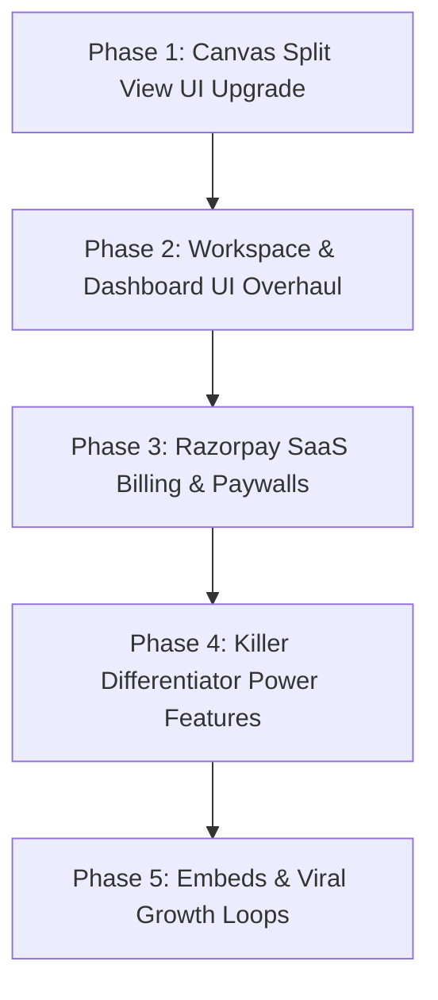

# Slate: SaaS Transformation & UI Overhaul — Master Implementation Plan

> **Target Execution Agent:** Claude Code / Anthropic Agent / Fullstack Engineering Team  
> **Tech Stack:** Next.js 16 (App Router), React 19, Convex Backend, Clerk Auth, Tiptap 3 Rich Document Editor, NVIDIA NIM AI (OpenAI-compatible), Tailwind CSS, Framer Motion, Razorpay.  
> **Payment Gateway:** **Razorpay** (Subscriptions & One-Time Orders with webhook HMAC verification).  
> **Repository Root:** `d:\slate`

---

## 1. Executive Summary & Market Positioning

Slate is an infinite canvas and documentation tool for software engineers. This plan details the transformation of Slate into a commercial **Developer Architecture & System Design SaaS** that outperforms competitors like *Eraser.io, Excalidraw, Miro, and tldraw*.

### Competitor Differentiation Matrix
| Capability | Miro / Lucidchart | Excalidraw | Eraser.io | **Slate (Target)** |
| :--- | :--- | :--- | :--- | :--- |
| **Canvas + Document Split** | ❌ No | ❌ No | ⚠️ Basic (50/50 only) | **✅ Draggable resizable splitter, presets, bidirectional sync** |
| **FinOps Cloud Cost Estimator** | ❌ No | ❌ No | ❌ No | **✅ Live $/mo cost badge on canvas for AWS/GCP nodes** |
| **Traffic Flow Simulator** | ❌ No | ❌ No | ❌ No | **✅ Interactive animated packet flow & SPOF warnings** |
| **Docker-Compose / Code to Diagram & Doc** | ❌ No | ❌ No | ⚠️ Diagram only | **✅ Simultaneous canvas graph + split markdown docs** |
| **System Design Interview Mode**| ❌ No | ❌ No | ❌ No | **✅ 45-min timer, requirement rubric, AI architecture grader** |
| **India & Global Payment Gateway** | Stripe only | Stripe only | Stripe only | **✅ Razorpay (Cards, UPI, Netbanking, Subscriptions)** |

---

## 2. Technical Architecture & Component Plans



---

### Phase 1: Canvas Split View UI & UX Overhaul

#### 1.1 Draggable Resizable Splitter
- **Target Files**: [`components/canvas/BoardShell.tsx`](file:///d:/slate/components/canvas/BoardShell.tsx), [`components/canvas/TopBar.tsx`](file:///d:/slate/components/canvas/TopBar.tsx)
- **Engine Logic**:
  - State: `splitRatio` (number, default `50`, clamped `20` to `80`).
  - Persist in `localStorage` under `slate_split_ratio`.
  - Handle dragging via pointer events (`onPointerDown`, window `pointermove`, window `pointerup`).
  - While dragging, append an overlay to prevent canvas/tiptap pointer event capturing.
  - Call `engine.requestRender()` smoothly on resize so canvas elements never distort.
  - Double-click on handle smoothly resets ratio to `50%`.

#### 1.2 Divider Visuals & Quick Presets
- 1px hairline border (`border-white/10`) with an 8px interactive hover hitbox.
- Center grip indicator (`GripVertical` icon) with glowing hover state (`bg-primary`).
- Hover Floating Preset Menu:
  - `[ 30% Doc | 50/50 | 70% Doc ]`
  - Quick collapse toggles: `Collapse Doc (<)` and `Collapse Canvas (>)`.

#### 1.3 Split Header Decoupling
- In `split` mode, decouple `TopBar`:
  - **Left Header (Document Pane)**: Slate title, word count / reading time, "Copy Markdown", "Insert Diagram Snapshot".
  - **Right Header (Canvas Pane)**: View mode switcher (`[ Canvas | Split | Doc ]`), Zoom controls, AI prompt button, Share modal.

#### 1.4 Bi-Directional Canvas ↔ Document Synergy
- Context menu action on canvas selection: *"Insert Snapshot into Document"*.
- Slash command in document editor: `/canvas-snapshot` captures selected canvas elements as SVG/PNG and embeds into Tiptap.

---

### Phase 2: Workspace & Dashboard UI Modernization

#### 2.1 Visual Aesthetic & Linear/Raycast Dark Theme
- **Target File**: [`app/dashboard/page.tsx`](file:///d:/slate/app/dashboard/page.tsx)
- Deep zinc backgrounds (`#09090b` / `#121215`), subtle 1px border glows, refined typography.

#### 2.2 Modern Workspace Switcher (Sidebar Top)
- Replaces raw workspace text list with a polished dropdown:
  - Displays Workspace Name, Initials Avatar, and Active Plan Tag (`FREE` vs `PRO` gradient pill).
  - Dropdown options: *"Workspace Settings"*, *"Invite Teammate via Email"*, *"Create New Workspace"*.

#### 2.3 Quick-Start Architecture Templates Shelf (Dashboard Top)
Horizontal scroll rail featuring 5 one-click starter cards:
1. ☁️ **AWS Microservices Architecture**: API Gateway, ECS Fargate, Aurora RDS, S3, CloudFront.
2. 🚀 **Next.js Fullstack Stack**: Next.js App Router, Convex backend, Clerk auth, Tailwind.
3. 🗄️ **Database ER Diagram (PostgreSQL)**: Users, Workspaces, Invoices, Subscriptions schema.
4. 🔐 **OAuth 2.0 & JWT Auth Flow**: Sequence diagram showing Client, Auth Provider, Resource Server.
5. ⚡ **System Design Interview Prep**: Empty canvas with 45-min timer & requirement rubric.
*Clicking any card clones the template and opens `/canvas/[newId]` instantly.*

#### 2.4 Rich Board Cards
- Display node count (`18 nodes • 12 connectors`).
- Collaborator presence dots & last edited relative timestamp.
- Favorite / Star toggle (`⭐ Starred`).
- Filter tags (`Backend`, `Infrastructure`, `Frontend`, `API Design`).

#### 2.5 Usage & Upgrade Meter (Sidebar Bottom)
- Progress bar displaying:
  - Free Slates used: `2 / 3 Slates created`
  - Monthly AI Diagram credits: `12 / 20 Credits used`
- Gradient CTA button: *"Upgrade to Pro"* triggering the Razorpay checkout modal.

---

### Phase 3: SaaS Monetization with Razorpay

#### 3.1 Pricing Tiers (INR & USD Ready)
- **Free Plan**: ₹0 / mo (3 Boards, 15 AI Credits/mo, personal workspace, standard export).
- **Pro Plan**: ₹999 / mo or ₹8,999 / yr (Unlimited Boards, 300 AI Credits/mo, 4K HD export, FinOps Cost Estimator).
- **Team Plan**: ₹1,999 / seat / mo (Unlimited Workspaces, Team Collaboration, Traffic Flow Simulator).

#### 3.2 Convex Backend Schema Extension
- **Target File**: [`convex/schema.ts`](file:///d:/slate/convex/schema.ts)
- Extend `users` table:
  ```typescript
  subscriptionTier: v.optional(v.union(v.literal("free"), v.literal("pro"), v.literal("team"))),
  subscriptionStatus: v.optional(v.union(v.literal("active"), v.literal("halted"), v.literal("cancelled"), v.literal("pending"))),
  razorpayCustomerId: v.optional(v.string()),
  razorpaySubscriptionId: v.optional(v.string()),
  razorpayPlanId: v.optional(v.string()),
  razorpayCurrentPeriodEnd: v.optional(v.number()),
  aiCreditsMonthlyCap: v.optional(v.number()),
  aiCreditsUsedThisPeriod: v.optional(v.number()),
  ```

#### 3.3 Razorpay Integration Flow
1. **Environment Variables** ([`.env.local`](file:///d:/slate/.env.local)):
   ```env
   RAZORPAY_KEY_ID=rzp_test_...
   RAZORPAY_KEY_SECRET=...
   RAZORPAY_WEBHOOK_SECRET=...
   NEXT_PUBLIC_RAZORPAY_KEY_ID=rzp_test_...
   ```
2. **API Routes**:
   - `app/api/billing/razorpay/create-subscription/route.ts`: Generates subscription ID via Razorpay API.
   - `app/api/billing/razorpay/verify-payment/route.ts`: Verifies HMAC SHA256 signature (`crypto`) and activates plan in Convex.
   - `app/api/billing/razorpay/webhook/route.ts`: Listens for `subscription.activated`, `subscription.charged`, and `subscription.cancelled`.
3. **UI Components**:
   - `components/billing/PricingModal.tsx`: Modal with Monthly/Annual toggle, feature list, and Razorpay Standard Checkout SDK loader (`https://checkout.razorpay.com/v1/checkout.js`).
   - `lib/billing/limits.ts`: Mutation wrapper enforcing tier caps (slates limit & AI credit limits).

---

### Phase 4: Killer Differentiators (Competitor Moat)

#### 4.1 FinOps Cloud Cost Estimator (Direct on Canvas)
- **Concept**: As users draw architectures with AWS/GCP/Azure nodes, Slate displays a floating badge: **Estimated Cloud Cost: $428 / mo**.
- **Implementation**:
  - File: `lib/finops/pricing-rules.ts`: Benchmark cost table (AWS EC2 t4g, RDS Postgres, S3, NAT Gateway, CloudFront, ALB, Lambda).
  - Canvas reactive hook: Analyzes all node types on canvas, computes total monthly estimate, and surfaces cost-optimization tips (e.g. *"Replace NAT Gateway with VPC Endpoint to save $32/mo"*).
  - Free users get aggregate $/mo; Pro users get per-node itemization & exportable FinOps CSV.

#### 4.2 Interactive Traffic Flow Simulator
- **Concept**: Showcase and test system architecture behavior via animated packet flows along connector arrows.
- **Implementation**:
  - Toolbar Toggle: *"Simulate Traffic"* button.
  - Animation: Renders glowing animated particles along connector lines using SVG `stroke-dashoffset` or canvas particle engine.
  - Graph Topology Validator: Scans nodes and flags Single Points of Failure (SPOF) with a pulsing warning badge (e.g. *"Auth Service has 4 dependent clients and 0 replicas"*).

#### 4.3 Docker-Compose / Code to Diagram & Doc
- **Concept**: Paste a `docker-compose.yml`, SQL schema, or directory structure -> Slate simultaneously generates the canvas diagram and the markdown documentation in the split editor.
- **Endpoint**: `app/api/ai/code-to-diagram/route.ts`
- **Output**:
  1. Nodes & smart connectors laid out via ELK layout engine on the canvas.
  2. Structured documentation inserted into the split Document Editor (service descriptions, port maps, environment requirements).

#### 4.4 System Design Interview Mode
- **Concept**: Dedicated canvas mode for technical interview practice and screening.
- **Components**:
  - Floating 45-minute countdown timer with pause/reset.
  - Requirement checklist drawer: Functional requirements, scale/throughput calculations, latency SLAs.
  - *"AI Architecture Reviewer"*: Reviews user's diagram against standard system design rubrics (Scalability, High Availability, Database Sharding, Caching layers).

---

### Phase 5: Embeds & Viral Customer Acquisition Loop

#### 5.1 Interactive Embed Route
- **Target File**: `app/embed/[id]/page.tsx`
- Lightweight read-only canvas supporting pan, zoom, and node click inspection.
- Embeddable in Notion, GitBook, Mintlify, and Confluence via `<iframe>`.
- Subtle bottom watermark: *"⚡ Powered by Slate — Create Infinite Architecture Diagrams"*, driving organic viral user acquisition.

---

## 3. Master Prompt for Claude Code (All-in-One Copy & Paste)

Copy and paste the entire prompt block below directly into **Claude Code**:

```markdown
You are an expert fullstack engineer working on Slate (`d:\slate`), an infinite canvas and documentation tool built with Next.js 16 (App Router), React 19, Convex Backend, Clerk Auth, Tiptap 3, and NVIDIA NIM AI.

Please implement the comprehensive SaaS transformation and UI upgrade detailed in `docs/IMPLEMENTATION_PLAN.md`. Execute the tasks in the following structured sequence:

### MILESTONE 1: Canvas Split View UI Overhaul
1. Target: `components/canvas/BoardShell.tsx` and `components/canvas/TopBar.tsx`.
2. Replace the hardcoded `w-1/2` split layout with a smooth, draggable split pane (clamped between 20% and 80%, persisted in `localStorage` under `slate_split_ratio`).
3. Add a sleek drag handle with `GripVertical` icon, double-click reset to 50%, and hover preset buttons: `[ 30% Doc | 50/50 | 70% Doc ]` with collapse toggles.
4. Decouple top headers in split mode: give the Document Pane a dedicated reading header (title, word count, markdown export) and isolate the Canvas toolbar controls on the right.
5. Ensure `engine.requestRender()` executes smoothly on resize without canvas coordinate jumping.
6. Add "Insert Canvas Snapshot into Doc" action to transfer canvas drawings into the Tiptap document.

### MILESTONE 2: Workspace & Dashboard UI Modernization
1. Target: `app/dashboard/page.tsx`.
2. Redesign the dashboard into a modern Linear/Raycast dark theme aesthetic (`#09090b` / `#121215`).
3. Build a "Quick-Start Architecture Templates" rail at the top (AWS Microservices, Database ERD, Next.js Stack, Auth Flow, System Design Interview).
4. Upgrade the Workspace Switcher in the sidebar to a dropdown showing workspace avatar, member count, and plan badge (`FREE` vs `PRO`).
5. Add a Usage & Storage Progress Meter at the bottom of the sidebar with an "Upgrade to Pro" CTA.
6. Upgrade board cards to display live node counts, collaborator presence dots, and favorite pin toggles (`⭐`).

### MILESTONE 3: Razorpay SaaS Billing & Paywall Integration
1. Extend `convex/schema.ts` users table with Razorpay subscription fields: `subscriptionTier`, `subscriptionStatus`, `razorpaySubscriptionId`, `razorpayPlanId`, `aiCreditsMonthlyCap`, `aiCreditsUsedThisPeriod`.
2. Create Razorpay API routes:
   - `app/api/billing/razorpay/create-subscription/route.ts` (creates subscription/order via Razorpay SDK).
   - `app/api/billing/razorpay/verify-payment/route.ts` (verifies HMAC SHA256 payment signature using crypto and updates user tier in Convex).
   - `app/api/billing/razorpay/webhook/route.ts` (handles subscription.activated, subscription.charged, subscription.cancelled).
3. Build `components/billing/PricingModal.tsx` with Monthly/Annual toggle (Free ₹0, Pro ₹999/mo, Team ₹1,999/seat/mo) and Razorpay standard checkout integration.
4. Implement gatekeeper utilities in `lib/billing/limits.ts` to enforce board creation caps and AI diagram credit limits.

### MILESTONE 4: Killer Differentiator Power Features
1. **FinOps Cloud Cost Estimator**:
   - Create `lib/finops/pricing-rules.ts` with benchmark pricing for AWS/GCP services.
   - Add a reactive floating badge on the canvas calculating estimated monthly cost ($/mo) based on placed cloud nodes.
2. **Interactive Traffic Flow Simulator**:
   - Add "Simulate Traffic" mode in canvas toolbar.
   - Render animated flowing particles along connector arrows using SVG stroke-dashoffset / canvas animation.
   - Inspect graph topology and display pulsing warning badges on Single Points of Failure (SPOFs).
3. **Docker-Compose / Code to Diagram & Doc**:
   - In AI panel, add "Import Code / Docker-Compose".
   - Parse services to lay out ELK canvas nodes and simultaneously write structured documentation into the split Tiptap editor.
4. **System Design Interview Mode**:
   - Add interview mode toggle with 45-minute countdown timer, requirement checklist, and AI architecture review feedback.

Please preserve existing codebase conventions, verify type correctness (`npm run typecheck`), and ensure all changes are robust and production-grade.
```
